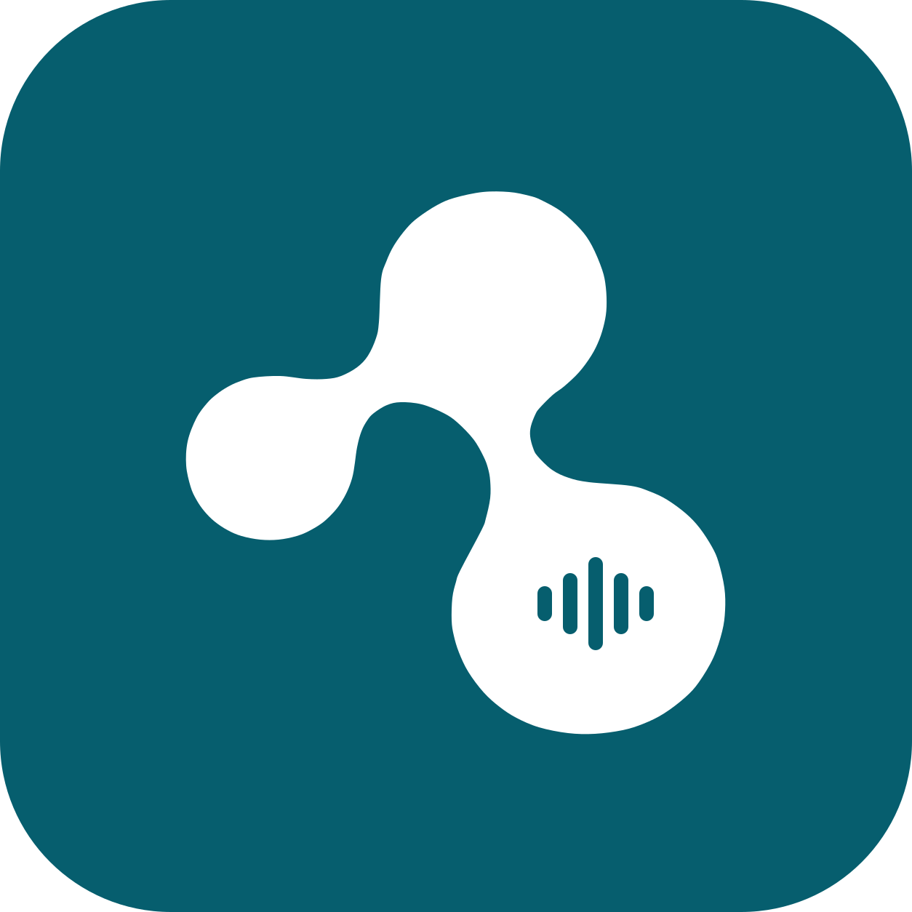

# 声邻

声邻让身边的设备在录音时自动为彼此降低媒体音量。Android、Mac、iPad 与 Windows 按设备直接配对，任一设备开始录音，都可请求已配对设备降低音量；结束后恢复。0.2 beta.1 起，Mac 本机协同保留输入应用的输出、降低其他应用；浏览器通过扩展逐页参与。iPad 本机协调交给系统，远端请求尊重本机输入与手动调整。菜单栏图标提供快速状态与控制。

> **早期预览版。** 目前以 ARM Android、Apple Silicon Mac、iPad 和 x64 Windows 真机为开发、测试目标。iPad 的录音检测与音量控制使用系统私有接口，系统更新可能改变行为；后台、锁屏和多设备协同仍需继续验证。

Android 版使用 Kotlin、Jetpack Compose 和 Material 3，源码位于 `Android/`，与更新后的 Mac、iPad 以及其他 Android 设备直接通过局域网配对和双向协同，不需要 Mac 中转。各端在“添加设备”中选择显示验证码，或发现对端并输入验证码。Android 的音量协同被动观察系统录音活动；独立的“共享内置麦克风”开关经麦克风权限与逐设备授权后，允许 Mac 按需使用输入。两种功能均由前台服务提供，并显示常驻通知。网络条件可选“同一 Wi-Fi”或“同一局域网”，再选择与蓝牙按“或”或“且”组合；局域网允许 Wi-Fi 与网线混用，Wi-Fi 条件要求双方实际认证链路均走 Wi-Fi。构建、安装及实际验证范围见[开发与诊断](manuals/开发与诊断.md)和[验收记录](docs/validation.md)。

Windows 版提供无 GUI 的命令行程序，可由 NSSM 作为服务管理。已配对设备可按输入设备授权共享麦克风；Mac 可挂载 Windows 输入为独立系统麦克风，录音应用选用时才会采集。协议使用通用 peer 与输入 ID，当前实现发送端为 Windows、Android 和 iPad，接收端为 Mac。0.2 beta.7 新增 Android／iPad 供源；真机验证范围见验收记录。iPad 须在前台开始供音，之后可锁屏持续；最后一个客户端停止后释放麦克风，需回到声邻前台恢复待用。

Mac 0.2 beta.8 新增远程麦克风的逐挂载输入增益，并修复诊断队列阻塞录音检测的问题。增益默认保留原始音量，可在专用麦克风设置中调高；其他平台本次沿用 beta.7 安装包。

## 下载与安装

从 [Releases](https://github.com/xiaoland/shenglin/releases) 下载 Android ARM APK（arm64 / armv7）、macOS DMG、iPad 无签名 IPA 和 Windows x64 ZIP。Android APK 使用独立发布签名，Android 8.0 起可安装；现有调试签名安装不能直接覆盖为发布版，卸载会丢失本机配对。macOS 包使用开发签名、未经 Apple 公证，系统可能阻止运行；iPad 包需用自己的免费 Apple 账号签名安装，无需下载源码，但需定期续签。从 0.2 beta.4 起，已准备声邻源码、Xcode 和 Rust 环境的 Mac 也可在“设置…”→“iPad 安装”中为 USB 连接的 iPad 构建、签名并覆盖安装。Windows 的安装、配对与共享步骤见 [Windows 使用说明](Windows/README.md)，其他平台详情见[安装与分发](manuals/安装与分发.md)。

安装后，在 iPad 上打开声邻并点“添加设备”；在 Mac 主窗口的“设备”中点“添加设备…”，选择 iPad 并输入它显示的六位验证码。两台 Mac 也可通过配对弹窗互相配对。[使用指南](manuals/使用指南.md)说明音量目标、应用排除、专用麦克风和诊断功能。

## 文档

- [使用指南](manuals/使用指南.md)：配对、日常控制和可选功能。
- [行为与限制](manuals/行为与限制.md)：录音判定、空间条件、隐私与当前边界。
- [开发与诊断](manuals/开发与诊断.md)：源码构建、驱动、CLI 与诊断工具。
- [验收记录](docs/validation.md)：真机证据和仍待验证的场景。

图标原稿、多配色与多尺寸素材、平台资源对应关系见 [Logo 素材指南](Design/README.md)。项目代码使用 [MIT 许可证](LICENSE)；第三方许可证保留在 [third_party](third_party)。
